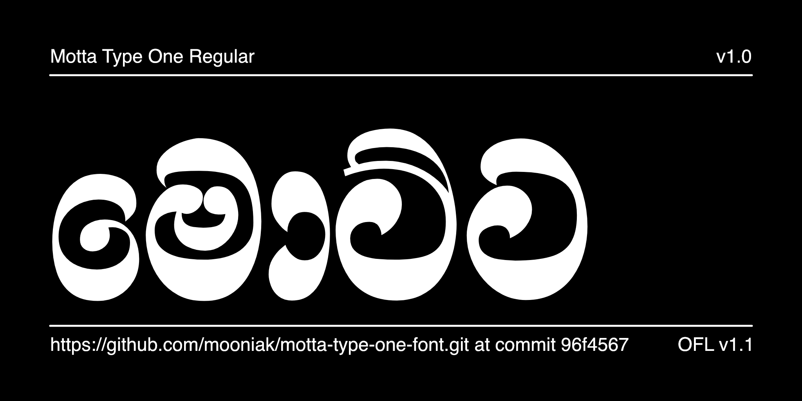
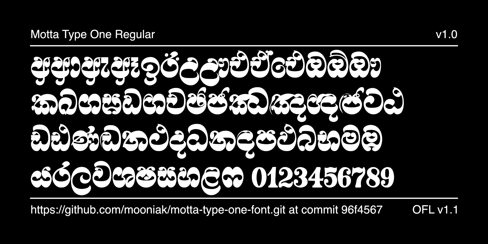

මොට්ට ටයිප් වන් / Motta Type One
==============

[![Build][badge-build]][link-build]
[![Fontspector QA][badge-qa]][link-qa]
[![Release][badge-release]][link-release]
[![License: OFL 1.1][badge-license]][link-license]

[badge-build]: https://github.com/mooniak/motta-type-one-font/actions/workflows/build.yaml/badge.svg?branch=dev
[badge-qa]: https://img.shields.io/badge/dynamic/json?url=https%3A%2F%2Fsrc.mooniak.com%2Fmotta-type-one-font%2Fbuild.json&query=%24.qa.pass_rate&suffix=%25&label=fontspector%20QA%20(dev%20build)&color=informational
[badge-release]: https://img.shields.io/github/v/release/mooniak/motta-type-one-font?label=release
[badge-license]: https://img.shields.io/badge/license-OFL--1.1-green
[link-build]: https://github.com/mooniak/motta-type-one-font/actions/workflows/build.yaml
[link-qa]: https://src.mooniak.com/motta-type-one-font/reports/fontspector/fontspector-report.html
[link-release]: https://github.com/mooniak/motta-type-one-font/releases
[link-license]: OFL.txt

Motta Type One is a heavy, rounded Sinhala display typeface designed by Damith Welikala and
published by [Mooniak](https://mooniak.com/) as a free font under the SIL Open Font License.

*Motta* (මොට්ට) means blunt. The letters are built from thick, soft-ended strokes with small
counters and almost no contrast, so they hold together as dark, friendly shapes at large sizes:
headlines, posters, signage, packaging and titles. It is a single Regular weight.




## Get the font

- **Download:** the [Releases](https://github.com/mooniak/motta-type-one-font/releases) page. A
  pre-release named `canary` is rebuilt from every push to `dev`; it is the latest development
  work and may be broken, so don't use it in production. Its family name ends in `CANARY` so it
  can be installed next to a release.
- **Proofs and QA:** the latest development build, with type proofs and the full Fontspector
  report, is at [src.mooniak.com/motta-type-one-font](https://src.mooniak.com/motta-type-one-font/).
- **Build it yourself:** see [Building the fonts from source](#building-the-fonts-from-source).

## Font data

| | |
|---|---|
| **Version** | 1.000 |
| **Script** | Sinhala (no Latin letters; ASCII digits and punctuation only) |
| **Styles** | Regular |
| **Formats** | TTF, OTF and WOFF2 (`MottaTypeOne-Regular.*`) |
| **Glyphs** | 469 (111 mapped to Unicode code points; the rest are conjuncts, rakar/yansaya forms and other glyphs used by OpenType features) |
| **Units per em** | 1000 |
| **Key heights** | x-height 385, ascender 770, descender −193 |
| **Vertical metrics** | ascent 900, descent −300, line gap 0 (`hhea`, typo and win; `USE_TYPO_METRICS` on) |
| **File size** | about 230 KB (TTF), 85 KB (OTF), 70 KB (WOFF2) |
| **Source format** | [Glyphs](https://glyphsapp.com/) 3 package (`sources/MottaTypeOne.glyphspackage`) |
| **License** | [SIL Open Font License 1.1](OFL.txt) |

### Character coverage

| Range | Encoded |
|---|---|
| Sinhala (U+0D80–0DFF) | 80 of 91. Not yet: candrabindu U+0D81 and the Sinhala Lith digits U+0DE6–0DEF |
| Basic Latin | space, digits 0–9 and `! " # $ % & ' ( ) * + , - . /` |
| Other | no-break space, ZWNJ, ZWJ, dotted circle (U+25CC) |

### OpenType features

The feature code is generated by [lankafea](https://github.com/mooniak/sinhala-font-tools)
(sinhala-font-tools/tools/feature-generator) from the glyphs in the source. Don't edit it by
hand; regenerate it after adding or drawing glyphs:

```sh
lankafea generate --script sinhala --font sources/MottaTypeOne.glyphspackage \
    --glyphs-out sources/MottaTypeOne.glyphspackage
```

| Layout table | Features |
|---|---|
| `GSUB` | `akhn` (conjuncts) `vatu` (rakar ligatures, a generic rakar for the other consonants, yansaya) `abvs` `blws` `psts` (consonant + vowel-sign ligatures) |
| `GPOS` | `dist` |

Not shipped yet, because their glyphs are not drawn: repaya (`rphf`), the below-base da-forms
(`daa._c-sinh`…), and the virama forms of gha + rakar, jha and nga. Those sequences fall back to
visible letters with a separate virama; see [CHECKLIST.md](CHECKLIST.md).

## Repository structure

| Path | What it is |
|---|---|
| `sources/MottaTypeOne.glyphspackage` | The font source: glyphs, kerning and OpenType feature code, as a Glyphs 3 package |
| `sources/config.yaml` | Build configuration read by [gftools](https://github.com/googlefonts/gftools) |
| `fontpackage.json` | Mooniak catalogue metadata (name, designer, tier, channels) |
| `Makefile` | Build, test and proof targets (see below) |
| `requirements.in`, `requirements.txt` | Python dependencies: the top-level list, and the pinned set used for builds |
| `fonts/`, `out/`, `_site/` | Build output, QA/proof reports and the proof site (created by `make`; not committed) |
| `documentation/` | Specimen images and their DrawBot scripts, the font description (`ARTICLE.en_us.html`), and `rename-map.tsv` (old glyph name → LankaGlyphset name) |
| `scripts/` | Helper scripts used by the Makefile and CI (from the Mooniak project template) |
| `CHECKLIST.md` | What's done and what's left before the font is complete |
| `OFL.txt`, `AUTHORS.txt`, `CONTRIBUTORS.txt` | License and credits |

Glyph names follow the [LankaGlyphset](https://github.com/mooniak/lanka-glyphsets) standard
(`ka-sinh`, `isign-sinh`, `kRa-sinh`…).

## Building the fonts from source

Building needs only free, open-source tools. You do **not** need Glyphs to build, only to edit
the source.

### Requirements

- **macOS or Linux** (on Windows, use [WSL](https://learn.microsoft.com/windows/wsl/)).
- **Python 3.12** with `venv` and `pip`, the version CI uses. The dependencies in
  `requirements.txt` are pinned, and other Python versions may fail to install them.
- **Make** and **git**, and network access for the first build.

### Build

```sh
git clone https://github.com/mooniak/motta-type-one-font.git
cd motta-type-one-font
python3.12 -m venv venv
make build
```

`make build` installs the pinned dependencies into `venv/` (first run only), then runs
[`gftools builder`](https://github.com/googlefonts/gftools) on `sources/config.yaml`, which
compiles the source with fontmake, autohints the TTF, fixes it with `gftools-fix-font` and
compresses a WOFF2. Output:

```
fonts/ttf/MottaTypeOne-Regular.ttf
fonts/otf/MottaTypeOne-Regular.otf
fonts/webfonts/MottaTypeOne-Regular.woff2
```

Each rebuild deletes and recreates `fonts/`. `make` compares timestamps against the package
folder, and editing a file inside the package doesn't change the folder's timestamp, so after
editing the source run `rm build.stamp && make build`.

### Quality checks and proofs

These need two extra tools, installed with
[`cargo binstall`](https://github.com/cargo-bins/cargo-binstall):

```sh
cargo binstall fontspector     # for `make test`
cargo binstall diffenator3     # for `make proof`
```

| Command | What it does |
|---|---|
| `make test` | Runs [Fontspector](https://github.com/fonttools/fontspector) with the Google Fonts profile (this is a free font) and writes HTML and Markdown reports to `out/fontspector/`. It doesn't stop on failures; read the report. |
| `make proof` | Runs `diff3proof` and writes an HTML proof to `out/proof/`. |
| `make pages` | Builds the stage-gated proof site into `_site/` (needs `make manifest` first for the QA verdict). |
| `make images` | Re-renders `documentation/image1.png` and `image2.png`. |
| `make clean` | Deletes `venv/`. |

### Build badges

The badges at the top come from the automated build, which runs on every push to `dev`:

- **Build** is the status of the latest
  [GitHub Actions run](https://github.com/mooniak/motta-type-one-font/actions/workflows/build.yaml)
  (build, QA, proofs, publishing).
- **Fontspector QA** is the pass rate of the Google Fonts profile on that same build, read from
  the build manifest on the [proof site](https://src.mooniak.com/motta-type-one-font/). It
  tracks the latest development build, not the tagged release.

Known failures, shared by Mooniak's other Sinhala-only fonts: the Google Fonts Latin coverage and
"render own name" checks (the font has no Latin letters), and the GF repository-layout check.

## Releases and versioning

Versions follow [OpenFV](https://github.com/openfv/openfv) (`MAJOR.MINOR`, three-digit minor).
Work happens on `dev`; `main` only moves when a release is cut.

| You want | Do this | CI publishes |
|---|---|---|
| the latest build | push to `dev` | the rolling `canary` pre-release and the proof site |
| a fixed preview for testers | tag a `dev` commit `vX.YYY-dev.N` | a GitHub pre-release |
| a release | merge `dev` into `main` (no squash), tag `main` `vX.YYY` | a GitHub Release |

Bump `versionMajor`/`versionMinor` in the source before tagging. The next release after the
2020 version 1.000 should be **1.001** or later.

## Contributing

Bug reports and design feedback are welcome in the
[issue tracker](https://github.com/mooniak/motta-type-one-font/issues). Open pull requests
against `dev`, make changes in `sources/MottaTypeOne.glyphspackage` with Glyphs 3, rebuild
(`rm build.stamp && make build`) and run `make test`. Add yourself to `CONTRIBUTORS.txt`.

## Credits

- **Design:** Damith Welikala (2020)
- **Production and publishing:** [Mooniak](https://mooniak.com/)

## Changelog

**18 November 2026, version 1.000 (development)**

- Moved to the Mooniak build pipeline: Glyphs 3 source converted from the FontForge UFO,
  LankaGlyphset glyph names, gftools builds with CI, proofs and QA.
- Fixed feature code that stopped the build, and removed rules that substituted into empty
  glyphs (repaya, three virama forms, ss01), which made text disappear.
- Added rules for seven drawn but unreachable conjuncts (fa, nD and ṣa with rakar + i/ii, ඳ්‍ර).
- Added no-break space and dotted circle; Google Fonts vertical metrics (line height 1.2 em);
  Mooniak copyright, designer, vendor ID and OFL licence in the font.

**2020, version 1.000.** Original design by Damith Welikala, made in FontForge.

## License

This Font Software is licensed under the SIL Open Font License, Version 1.1. This license is
available with a FAQ at https://openfontlicense.org
