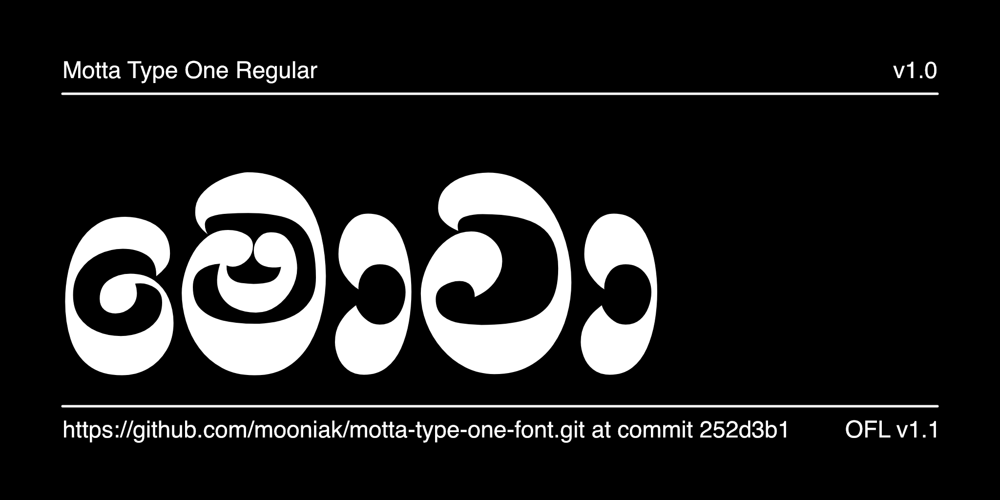
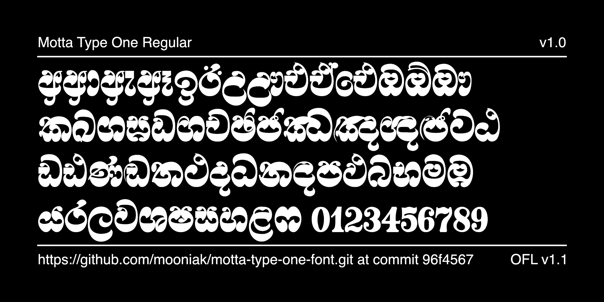

මොටා ටයිප් 1 / Motta Type One
==============

[Read in English](README.md)

ඇත්ත පුවත්පත වෙනුවෙන් 1960 දශකයේදී මොටාගෙදර වනිගරත්න සූරින් විසින් නිර්මාණය කරන ලද මොටා ටයිප් අකුරු මෝස්තර එකතුවෙන් තෝරාගත් මෝස්තරයක් ඇසුරින් මෙම ෆොනුරුව සකස් කොට ඇත. අඩසියවසකට ආසන්න කාලයක් පුරා ඇත්ත පුවත්පතේ මුල් පිටුවේ ප්‍රධාන සිරස්තලය හැඩ කරන්නට යොදා ගත් මෙම අකුරු මොස්තරය එවක ඉතාමත් ජනප්‍රියත්වයට පත්ව තිබූ අකුරු මෝස්තරයක් විය.

අක්‍ෂරවල ඉහළ සහ පහළ දාර වැඩි ගණකමකින් යුතුව නිර්මාණය වී තිබීමත් අක්‍ෂරාන්ත (Typographic terminals) සඳහා පැරණි සිංහල කැටයම් රටා භාවිත කොට තිබීමත් මෙහි ඇති විශේෂත්වයයි. අක්‍ෂරයේ ස්වභාවය අනුව පිලි වර්ග කිහිපයක් භාවිතා කොට ඇති අතර ක,ත,න අක්‍ෂර 3 සඳහා වෙනම ඉස්පිල්ලක් භාවිත වී තිබීමද විශේෂත්වයකි. පරිගණක අක්‍ෂර කලාව මෙරට ප්‍රචලිත වීමත් සමඟ පැරණි අච්චු අකුරු මෝස්තර රැසක්ම භාවිතයෙන් ඉවත් වූ අතර මොටා ටයිප් අකුරු මෝස්තර එකතුව ද ඒ අතර විය.

අක්‍ෂර නිර්මාණ ශිල්පී දමිත් වැලිකල විසින් 2020 වසරේ දී Motta Type 1 නමින් මෙම අකුරු මෝස්තරය ෆොනුරුවක් ලෙස ප්‍රතිනිර්මාණය කරන ලද.

- **බාගත කිරීම:** [Releases](https://github.com/mooniak/motta-type-one-font/releases)
- **බලපත්‍රය:** SIL Open Font License 1.1 ([OFL.txt](OFL.txt))
- **ප්‍රකාශනය:** [Mooniak](https://mooniak.com/)

තාක්ෂණික තොරතුරු සහ ගොඩනැගීමේ උපදෙස් සඳහා [ඉංග්‍රීසි README](README.md) බලන්න.
